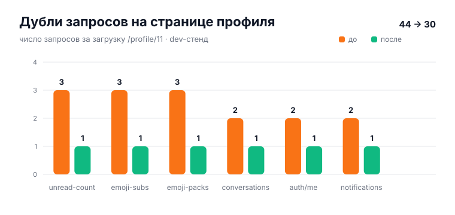

# Оптимизация: болтливость фронта (дубли запросов)

> **TL;DR** — страница профиля делала **44 запроса**, из них 12 — дубли:
> `unread-count` ×3, `my-emoji-subscriptions/packs` ×3, `conversations` ×2,
> `auth/me` ×2, `notifications` ×2, `friends/status` ×4. Причина везде одна:
> два независимых механизма читали одно и то же без общего кэша. Лечение
> везде одно: **один владелец запроса + in-flight дедуп + TTL**. Стало **30**
> запросов, каждый уникальный эндпоинт — по одному разу (остаточные ×2 —
> артефакт React StrictMode в dev, в проде ×1).

## Диагноз по эндпоинтам



| Эндпоинт | Было | Стало | Причина дублей |
|---|---|---|---|
| `notifications/unread-count` | 3 | **1** | `notificationStore.init` + `eventManager.syncAll` — два независимых fetch |
| `my-emoji-subscriptions` / `my-emoji-packs` | 3+3 | **1+1** | драйверы mount/auth-change/focus без общего in-flight и свежести |
| `messenger/conversations` | 2 | **1** | `init→loadConversations` + следом `startSync→syncAll→listConversations` |
| `auth/me` | 2 | **1** | `messengerApi.getMyProfile` шёл мимо кэша + сырой fetch в OAuthConsent |
| `notifications?limit=20` | 2 | **1** | гонка двух `init()` до выставления флага |
| `friends/status/:id` | 4 (dev) / 2 (прод) | **1** | свой fetch у страницы + свой у FriendButton |

## Что сделано

- **`stores/notificationStore`** — `initialized` выставляется синхронно (закрыта
  гонка StrictMode), `fetchUnreadCount(force?)` с in-flight дедупом и TTL 15 с.
- **`services/eventManager`** — `syncAll` больше не имеет собственных
  запросов: бейдж делегирован стору уведомлений, диалоги — стору мессенджера
  (динамический импорт — стор уже импортирует менеджер статически, обратный
  статический импорт был бы циклом); конкурентные синки схлопываются.
- **`stores/messengerStore`** — `loadConversations({ force? })` с in-flight +
  TTL 30 с, возвращает снапшот для колбэков; `init`, ShareSheet и ресинк
  переиспользуют свежее; `group_updated` идёт с `force: true` (редкое
  серверное событие, а не периодический синк). Тест-ресет
  `__resetConversationCacheForTests` по прецеденту outbox.
- **`services/messengerApi.getMyProfile`** — через кэшированный
  `getCurrentUser` (30 с); контракт «not authenticated» для разлогина сохранён.
- **`contexts/EmojiDataContext`** — `loadSubscribedData(force?)`: один
  in-flight на все драйверы + TTL 60 с на пользователя; мутации
  (subscribe/unsubscribe) инвалидируют принудительно.
- **`pages/OAuthConsent`** — сырой `fetch("/api/v1/auth/me")` заменён общим
  кэшированным вызовом; приоритет фолбэков приведён к старому порядку
  (сессия выше метаданных).
- **`stores/friendsStore` + `pages/Profile`** — страница больше не имеет
  собственного `friends/status` fetch: статус читается из общего стора
  (in-flight дедуп на пользователя), гарды приватности подписаны на карту
  reactive — дружба через FriendButton обновляет их без перезагрузки
  (раньше страница оставалась в старом состоянии до reload).

## Как воспроизвести графики

```bash
python3 docs/scripts/gen-feed-charts.py   # + opt-chatter-counts.svg
```

## Вторая волна: каталог, борда, лайки

- **Каталог GomoSub (бэкенд, миграция 141)** — `member_count` + `channel_count`
  denormalized на `boards` (триггеры + backfill, сверены), каталог читает
  колонки вместо 2 `COUNT(*)` на строку; заодно ограничен сверху
  (`?limit`, default 200, max 500) — раньше сканировался весь каталог без
  лимита. Контракт ответа не менялся.
- **Membership борды ×3 → ×1** — приват-гейт, фильтр приватных каналов и
  кнопка вступления читали один и тот же запрос тремя fetch'ами. Единый
  `utils/gomosubMembership.ts` (in-flight + TTL 60 с, инвалидация на
  join/leave): на `/g/test` остался ровно один борд-запрос.
- **Тултипы лайков** — `get_recent_*_likers` на каждый ховер без переиспользования.
  Кэш 60 с на пост/тред + in-flight, инвалидация на toggle (свой лайк меняет
  recent-3).

Замер: новый таб → `/profile/11` → 3 с → все `/api/v1/*` из network-панели
(dev-стенд `:8081`, StrictMode удваивает эффекты — остаточные ×2 в таблице
выше это dev-артефакт, в прод-сборке их нет).
