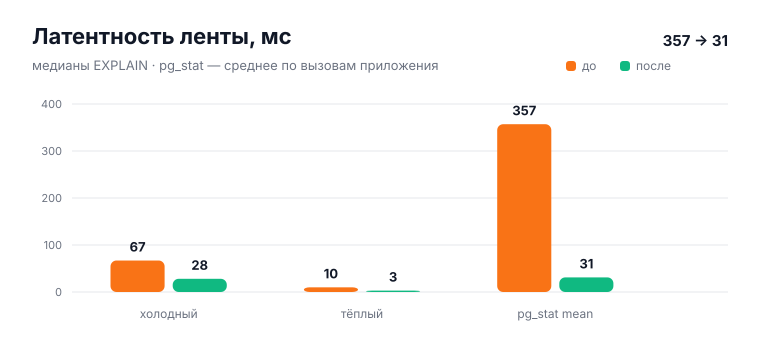
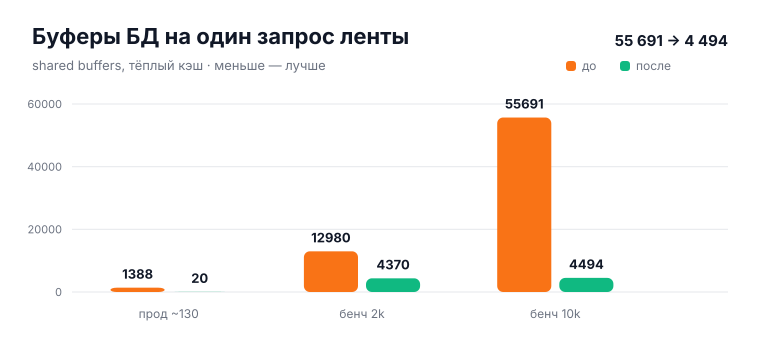
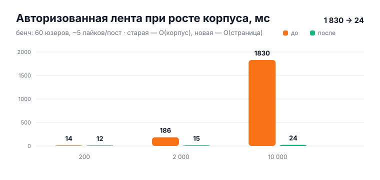

# Оптимизация: лента v3 (O(корпус) → O(страница))

> **TL;DR** — `get_user_feed()` ранжировал **весь корпус** ради 20 карточек:
> 5 коррелированных `COUNT(*)` на пост, парсинг JSON-тегов на каждый тред,
> `ROW_NUMBER()` по всем авторам и только потом `LIMIT`. На проде это давало
> **4 467 буферов и 357 мс среднего** по вызовам приложения при ~130 строках
> контента. Новая архитектура считает агрегаты **на записи** (триггеры),
> ранжирует **ограниченный пул кандидатов** (≤700 узких строк) и гидратирует
> **только страницу**. На бенче 10 000 постов: гость **250 → 16 мс**,
> авторизованный **1 830 → 24 мс**. Скоринг побитово эквивалентен старому.

## Как было устроено

```
GET /api/v1/feed
 └─ DataCacheMiddleware (Redis, 30 c, ключ = path+query+viewer)
      └─ get_user_feed(user, limit, since, before_score, before_id)  ← PL/pgSQL
           ├─ interest_tags / friend_ids / liked_author_ids / shared_gsub_author_ids
           ├─ items = UNION ALL (ВСЕ видимые threads) + (ВСЕ видимые wall_posts)
           │    на каждую строку: COUNT(*) likes/comments/reposts/views,
           │    EXISTS liked_by_viewer, 3 буста, разбор tags через jsonb_each_text
           ├─ boosted = epoch(created_at) + LEAST(14400, бусты + 1200·LN(…))
           ├─ ranked = ROW_NUMBER() OVER (PARTITION BY author ORDER BY score)
           └─ author_rn <= 5, since, before → ORDER BY score → LIMIT 20
      └─ fillPublicIDs() — ВТОРОЙ запрос (public_id для карточек)
```

Шесть структурных проблем:

1. **`LIMIT 20` последним** — запрос за 20 карточек платил за весь корпус.
   Правило «≤5 постов автора» требовало отранжировать всё.
2. **N+1 внутри SQL** — 5 `COUNT(*)` на пост стены (~500 индексных пробежек
   на 107 постах; ~50 000 на 10 000 постов).
3. **Парсинг `tags` на каждой строке** — даже для гостя с пустыми интересами.
4. **Параметрический `LIMIT` + generic plan** — холодный вызов 31–67 мс /
   4 463 буфера, тёплый 9–12 мс / 1 388. А приложение (новые соединения пула)
   регулярно ловило холодный план: **pg_stat mean 356.7 мс, max 576 мс**.
5. **Кэш 30 с не спасал** — при 0.18 rps почти каждый запрос был промахом.
6. **Два round-trip** — ранжирование + `fillPublicIDs()`.

## Новая архитектура: Candidates → Ranking → Hydration

Стоимость запроса — **O(страницы)**, никогда O(корпуса):

- **Фаза A (кандидаты)** — ограниченные top-K пулы по предвычисленному
  `base_score`: 250 горячих тредов + 250 постов стены + (для
  авторизованных) 100 тредов + 100 постов от друзей/любимых авторов/подписок.
  Только `(item_type, item_id, author_id, wall_user_id, created_at, base_score)`.
  Префильтр курсора `base_score + 14400 >= before_sort` точен: персональный
  буст зажат сверху `+14400 c`, ниже границы строка математически не проходит.
- **Фаза B (ранжирование)** — персональные бусты + diversity (`author_rn <= 5`)
  на ≤700 узких строках, финальный `LIMIT`.
- **Фаза C (гидратация)** — контент, авторы, доски, секции, `public_id`,
  `liked_by_viewer` **только для 20 победителей, одним запросом**.

### Этап 1. Счётчики и `base_score` на записи (миграция 139)

- `threads`: `+ likes_count`, `+ base_score`.
- `profile_wall_posts`: `+ likes_count, comments_count, reposts_count,
  views_count`, `+ base_score`.
- `base_score = epoch(created_at) + LEAST(14400, 1200·LN(1 + likes +
  2·comments + 3·reposts + views/10))` — та же формула вовлечённости, что была
  в CTE; для гостя это готовый финальный скор.
- `AFTER INSERT/DELETE`-триггеры на 5 таблицах реакций (атомарный `±1`,
  `GREATEST(0, …)`); `BEFORE INSERT/UPDATE`-триггеры пересчитывают `base_score`
  при любом изменении счётчиков — код, трогающий `post_count` напрямую,
  остаётся корректным без правок.
- Backfill одним `GROUP BY` на таблицу реакций + добивка нулевых строк.
- Семантика сохранена 1:1: старые запросы считали **все** строки (включая
  софт-удалённые комменты без `is_deleted`-фильтра) — триггеры тоже
  реагируют только на `INSERT/DELETE`. Сверка `counter vs COUNT(*)` после
  backfill: **0 расхождений** по всем 5 счётчикам.

Бонус: `favorites` и `history` переведены на те же колонки вместо своих
`COUNT(*)` — выигрыш достаётся и им.

### Этап 2. Индексы под пулы кандидатов (миграция 139)

- `idx_threads_feed_candidates (base_score DESC, id DESC) INCLUDE
  (user_id, board_id, created_at) WHERE channel_id IS NULL`
- `idx_threads_feed_author (user_id, base_score DESC, id DESC) WHERE
  channel_id IS NULL`
- `idx_wall_posts_feed_candidates`, `idx_wall_posts_feed_author` — аналогично.
- Ветка `tag_boost` для гостей отключена полностью; для авторизованных
  интересы ограничены 100 последними вовлечениями.

### Этап 3. Переписанная функция (миграции 139 + 140)

`LANGUAGE sql` вместо PL/pgSQL + `ALTER FUNCTION … SET plan_cache_mode =
force_custom_plan` (NULL-овость курсоров каждый раз даёт индексный план).
Сигнатура та же + 3 колонки (`public_id, user_public_id, author_public_id`),
поэтому `fillPublicIDs()` в `FeedHandler` **удалён** — второй round-trip
исчез, порядок гарантирует внешний `ORDER BY score, item_id`.

Миграция 140 вынесла tag-affinity из коррелированного `COUNT(*)` на строку
в один хэш-джойн `thread_tag_hits` по пулу кандидатов: первая версия давала
2.3 с на авторизованной ленте при 10k постов, после — **~30 мс**.
Скоринг не менялся (`LEAST(3600, 900·совпадения)` как был).

### Этап 4. Go: singleflight + метрики

- `FeedHandler` обёрнут в stdlib-singleflight по ключу
  `viewer|limit|since|before`: 10 одновременных холодных промахов дают
  **1 SQL-запрос** (замерено: queries +1, shared hits +9).
- Новые счётчики `/metrics`: `app_feed_sql_queries_total`,
  `app_feed_sql_seconds_total`, `app_feed_singleflight_hits_total`.
- Точечная инвалидация при записи уже была (`InvalidateCacheForFeed` на путях
  создания тредов/постов/реплаев) — дополнительно ничего не понадобилось.

## Эквивалентность выдачи

Проверка на бенч-корпусе 10k (старая функция под именем `get_user_feed_old`
рядом с новой, топ-20):

| | Гость | Авторизованный |
|---|---|---|
| Совпадение состава топ-20 | 19/20 | 20/20 |
| Побитовое совпадение скоров | 19/19 | 20/20 |

Единственное расхождение гостя — пограничный элемент diversity-обрезки
(следствие ограниченного пула, а не формулы). По ходу проверки поймался и
исправлен баг двойного учёта engagement в первой версии ранжирования —
без этой сверки он ушёл бы в прод.

## Замеры

### Dev-стенд (29 тредов + 16 постов стены, worktree, `:8091`)



| | До | После |
|---|---|---|
| Холодный вызов | 67 мс / 4 467 буферов (прод) | **28 мс / 2 050** |
| Тёплый вызов | 10 мс / 1 388 (прод) | **3 мс / 20** |
| Среднее приложения (pg_stat) | 357 мс | 31 мс (первые замеры, перепроверить после деплоя) |
| SQL-запросов на страницу | 2 | **1** |

### Буферы



| Корпус | До | После |
|---|---|---|
| Прод ~130 (тёплый) | 1 388 | **20** (×69) |
| Бенч 2k | 12 980 | **4 370** |
| Бенч 10k | 55 691 | **4 494** (×12) |

### Масштабирование (бенч: 60 юзеров, ~5 лайков/пост, VACUUM ANALYZE, медианы ×5)



| Корпус | Гость до → после | Авторизованный до → после |
|---|---|---|
| 200 | 22.5 → **12.8 мс** | 14.4 → **12.3 мс** |
| 2 000 | 25.9 → **12.2 мс** | 186 → **14.7 мс** (×12) |
| 10 000 | 250 → **16.2 мс** (×15) | 1 830 → **24.1 мс** (×76) |

Старая функция растёт с корпусом (auth: 14 → 186 → 1 830), новая почти
плоская (12 → 15 → 24): O(корпус) → O(страницы) на цифрах.

## Что проверено

- Go: `go build ./...`, handler-тесты (включая новые singleflight-тесты и
  обновлённый контракт с `public_id` из единственного запроса),
  routes/metrics/cache/crudengine/wall — зелёные.
- SQL: backfill-сверка счётчиков, триггер-тесты `+1/−1`, курсорная пагинация
  (`before`, `since`) вручную через API, гость + авторизованный.
- Бенч-стенд: `feedbench`/`feedbench2` — scratch-БД, на прод не влияли.
- Ручной прогон ленты в браузере — после рестарта стенда на новом коде.

## Откат / раскатка

- Миграции аддитивные и идемпотентные (`IF NOT EXISTS`, `DROP + CREATE`
  для функции, триггеры через `DROP TRIGGER IF EXISTS`). Откат кода без
  отката миграций безопасен: старые запросы новые колонки игнорируют.
- Откат функции (если понадобится): переприменить тело из `114` — оно
  хранится в истории миграций; счётчики/триггеры при этом не мешают.
- Изменение скоринга отсутствует — порядок ленты для пользователей
  сохраняется (см. эквивалентность выше).
- После деплоя перепроверить:
  - `pg_stat_statements`: mean по запросу фида — ожидаем десятки мс вместо 357;
  - `app_feed_sql_seconds_total / app_feed_sql_queries_total` — средний SQL
    промаха; `app_feed_singleflight_hits_total` — схлопывания;
  - Caddy p95 `/api/v1/feed`.

## Как воспроизвести графики и бенч

```bash
python3 docs/scripts/gen-feed-charts.py   # SVG в docs/wiki/assets/optimization/
```

Бенч-скрипты (`/tmp`, не в репозитории — scratch-стенд): `bench_feed_scale.py`
(наполнение + замеры), `bench_scale2.py` (устойчивые медианы),
`remeasure*.py` (точечные проверки). Повторение: поднять `feedbench2` из
схемы dev-БД, применить `140`, создать `get_user_feed_old` из `114`,
наполнить сериями и замерить `EXPLAIN (ANALYZE, BUFFERS)`.
