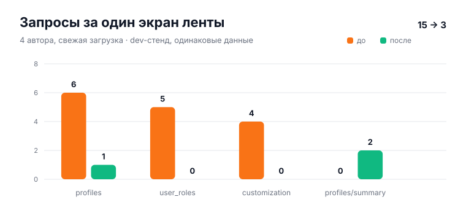
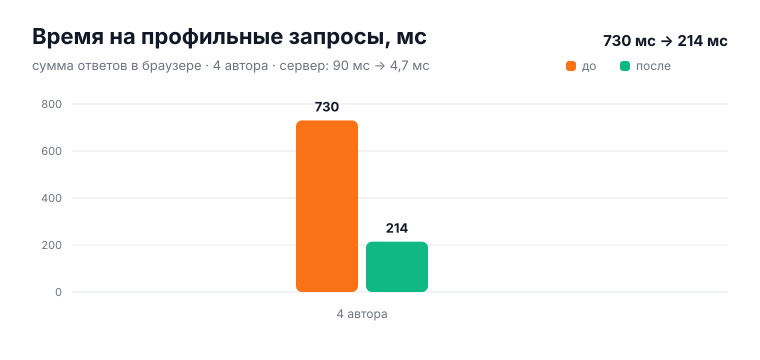
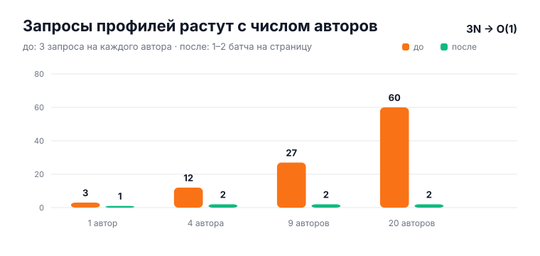
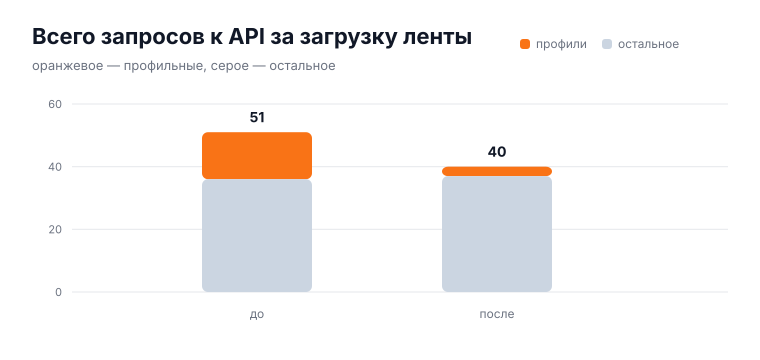

# Оптимизация: батчинг профилей (N+1 → один запрос)

> **TL;DR**‑карточка ленты с четырьмя авторами делала **15** профильных запросов
> (`profiles` + `user_roles` + `customization` на каждого). Теперь — **2–3**
> (`profiles/summary` на пачку), серверное время на тех же данных упало с
> **~90 мс до ~4,7 мс**, суммарное время в браузере — с **730 мс до 214 мс**.

## Проблема

Классический HTTP N+1 на клиенте: страница получала ленту одним запросом, а потом
**на каждого автора** каждый `<UserBadge>` независимо тянул три эндпоинта:

```
<UserBadge userId=…>
 ├─ GET /api/v1/users/<id>/customization     (ник, бейдж)
 └─ <AdminBadge userId=…>
      └─ GET /api/v1/profiles?id=eq.<id>    (username, avatar, public_id)
         GET /api/v1/user_roles?user_id=eq.<id>  (флаг админа)
```

3 запроса × N авторов. На проде это давало:

| Эндпоинт | Запросов за 24 ч | Доля реального трафика |
|---|---:|---:|
| `/api/v1/profiles` (по одному) | 2 580 | |
| `/api/v1/user_roles` | 1 908 | |
| `/api/v1/users/:id/customization` | ~2 400 | |
| `/api/v1/user_terms_acceptance` | 885 | |
| **Итого профильное** | **~7 700** | **~70 %** из ~11 тыс. |

По логам Caddy один клиент делал **33** таких вызова в минуту при **9** уникальных
авторах — ровно `3N + свои`.

Кэш не спасал: `ProfileCacheContext` и `profileCustomization` кэшировали **по
одному id** (TTL 5 мин), поэтому холодная загрузка всё равно давала `3N`, а
`loadProfile` пересоздавался на каждое изменение кэша и перезапускал эффекты
бейджей.

## Решение

### Бэкенд: `GET /api/v1/profiles/summary?ids=…`

Один публичный эндпоинт (OptionalAuth) на всё, что нужно бейджу:

```
GET /api/v1/profiles/summary?ids=<uuid|public_id>,<...>
```

- до **100** id за вызов, UUID и «цифорки» (`/profile/42`) в одном списке;
- поля: `id, public_id, username, display_name, avatar_url, nickname_emoji_id,
  is_admin, customization { … }`;
- **3 запроса в БД** независимо от N: пользователи, кастомизация, роли; плюс
  существующий `privacy.ResolveProfileVisibilityBatch` (1–2 запроса);
- `is_admin` — булев флаг для всех, полный список `roles` — **только для своей
  строки** (нужен хедеру/меню, чужие роли не раскрываются);
- кастомизация проходит тот же `SanitizeProfileCustomizationRow`, что и
  owner-read; скрытый аватар (`private_hide_avatar`) вырезается;
- email и owner-only поля не выбираются вообще.

Файлы: `internal/api/handlers/profile_summaries.go`,
`internal/api/routes/routes.go`, `internal/metrics/app.go` (+ счётчики
`app_profile_summary_requests_total`, `app_profile_summary_ids_total`).

### Фронтенд: DataLoader вместо 3N

`apps/web/src/utils/profileSummaryLoader.ts` — модульный батчер:

- `requestProfileSummary(id)` не фетчит сразу: складывает id в очередь и через
  `setTimeout(0)` отправляет **один** запрос на все id, запрошенные в этом тике
  (эффекты всех бейджей одного коммита попадают в одну пачку);
- дедуп in-flight и кэш на 5 минут (промах — 30 с), ключи по UUID **и** public id;
- `profile-cache:invalidate` чистит запись (scoped) или весь кэш; generation
  не даёт «просроченному» ответу воскресить старые данные;
- чанки по 100 id;
- **legacy-fallback**: если summary-роут отвечает 404/405/5xx (rolling deploy,
  новый фронт + старый бэк), батчер временно идёт старыми тремя эндпоинтами —
  бейджи деградируют в «медленно», а не в «без стиля».

`ProfileCacheContext` сохранил прежний API (`getProfile`, `loadProfile`,
`clearCache`), поэтому `HeaderUsername`, `AppLayout`, `AdminBadge`,
`NotificationItem`, `TransactionDetail` не пришлось переписывать. Бонусом
`loadProfile`/`getProfile` стали стабильными — эффекты бейджей больше не
перезапускаются на каждый cache write.

`getProfileCustomization` теперь просто проекция summary-кэша, а
`getCurrentUserMeta` (свои роли/ник/аватар) использует тот же батч — отдельные
`profiles` + `user_roles` для себя исчезли.

## Замеры

**Стенд:** локальный dev (worktree `perf/optimizations`), Vite `:8082` → backend
`:8091`, те же данные (4 автора в ленте, seed 24 треда + 8 wall-постов).
**Метод:** новый таб → `/feed` → ждём 3 с → считаем все `/api/v1/*` из network
панели; скролл до конца не догружает ленту (фиксированный `limit=21`).

### Профильные запросы на экран



| Метрика | До | После | Δ |
|---|---:|---:|---:|
| `profiles` по одному | 6 | 1\* | −83 % |
| `user_roles` | 5 | 0 | −100 % |
| `customization` | 4 | 0 | −100 % |
| `profiles/summary` | 0 | 2 | — |
| **Всего профильных** | **15** | **3** | **−80 %** |
| Всего запросов к API | 51 | 40 | −22 % |

\* один прямой `profiles?select=username,avatar_url` остался в `MobileMenu` и к
бейджам отношения не имеет — его можно убрать отдельным маленьким PR.

### Время



| Метрика | До | После |
|---|---:|---:|
| Сумма ответов в браузере (4 автора) | 730 мс | 214 мс |
| Серверное время на 4 авторов | ~90 мс (12 запросов) | **~4,7 мс** (1 batch) |
| 5 замеров batch (4 id) | — | 1,9–8,7 мс |

### Масштабирование



До — линейно `3N` (на проде при 9 авторах это 27 запросов). После — `O(1)`:
1 запрос на себя + 1 на всех авторов страницы, независимо от их количества.

### Общая картина запросов



## Что проверено

- Go: `go build ./...`, handler-тесты (пустой список, >100, мусор, гость,
  public id, приватный аватар, санитайзер CSS), route-тесты, metrics-тесты.
- Web: `tsc --noEmit`, eslint, **287 файлов / 2 988 тестов** — зелёные.
- Ручной прогон в браузере: лента рендерится, ошибок в консоли нет, иконка
  админа и кастомные ники на месте.

## Откат / раскатка

- Эндпоинт аддитивный: старый фронт его не вызывает, новый бэкенд ничего не
  ломает.
- Новый фронт + старый бэкенд: summary 404 → legacy-fallback на 3 старых запроса.
- Метрики для проверки после деплоя:
  - `sum(rate(http_requests_total{route="/api/v1/user_roles"}[1h]))` → ~0;
  - то же для `/api/v1/users/:id/customization`;
  - `rate(app_profile_summary_requests_total[5m])` > 0;
  - `app_profile_summary_ids_total / app_profile_summary_requests_total` ≈
    средний размер батча (ожидаем 5–20).

## Как воспроизвести графики

```bash
python3 docs/scripts/gen-optimization-charts.py
```

SVG лежат в `docs/wiki/assets/optimization/`.
